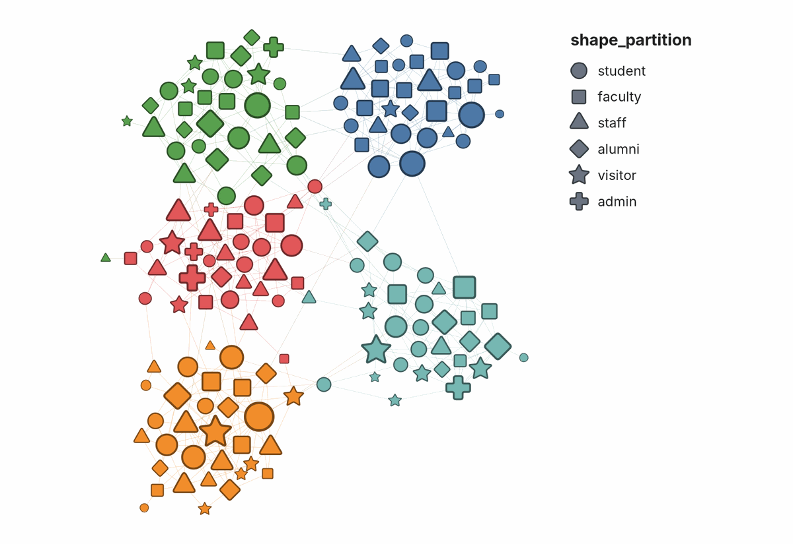
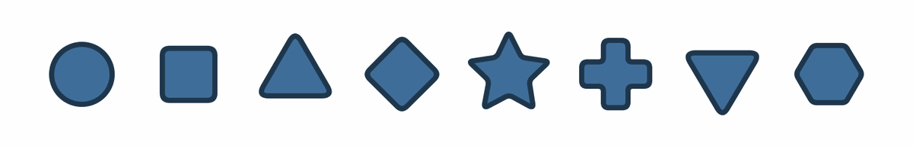
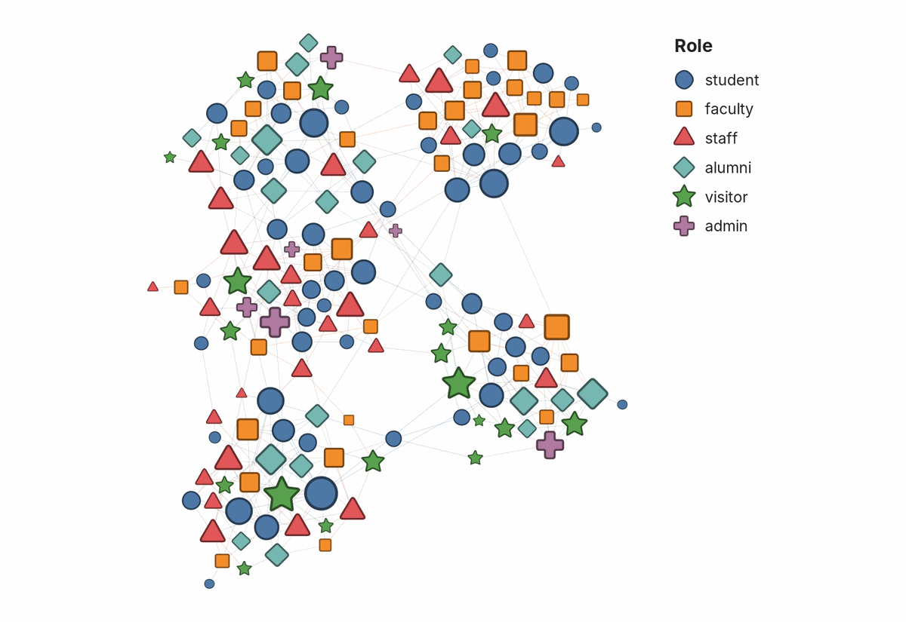

## Shape by Partition

Assign node shape automatically from a categorical attribute, the shape
equivalent of color by partition.

Gephi can already map a partition onto node color. It cannot map one onto node
shape, because a node has no shape property: shape only exists at render time.
This plugin adds a Preview renderer that reads a categorical node column and
draws each node as the shape assigned to its category.



### What it covers

| | Shapes? |
|---|---|
| **Preview** tab | Yes |
| PNG, SVG, and PDF exports | Yes, with a legend |
| **Overview** (the main graph window) | **No.** Nodes there stay circles. |
| **Appearance** panel | No. Shapes are set in Preview, from a column. |
| Saved `.gephi` projects and GEXF files | The column is saved, so the shapes come back when the file is reopened. GEXF's own `viz:shape` field is not written or read. |

Circles in Overview are not a bug. Overview is drawn by a separate OpenGL
engine that this plugin does not extend, and Gephi has no shape property on
nodes that Overview could read, so the shapes exist only where Preview draws
the graph. Overview is for exploring; the figure you publish comes from
Preview, and that is where the shapes are.

### Using it

1. Open the **Preview** tab.
2. Under **Nodes**, set **Shape partition column** to the name of the node
   column holding the categories.
3. Refresh.

A legend appears beside the graph, saying which shape stands for which
category. Turn it off with **Shape legend**, or give it a heading with **Shape
legend title** (left empty, it uses the column's title). Both are under
**Nodes**.

When colour encodes a different column from shape, name that column in
**Colour legend column** and the legend adds its colours below the shapes. One
key then explains both, for example shape for discipline and colour for project
group. **Colour legend title** gives that section a heading (left empty, it
uses the column's title).

Or set nothing: with the column field empty the renderer reads a node column
named `shape_partition`. A file that ships that column is shaped on import with
nothing to configure, and any tool that can write a node attribute can drive
the plugin without touching Preview properties at all. A name that *is* given
and does not resolve is never quietly replaced by the convention, because a map
that looks right and means something else is worse than circles.

### Other plugins that draw nodes or arrows

> **If you also use Polygon Shaped Nodes, or any other plugin that draws nodes
> or arrows, only one of them can be on at a time.** Choose which in
> **Preview > Manage Renderers**. If shapes do not appear after installing this
> plugin, check there first.

This plugin replaces two of Gephi's built-in Preview renderers and adds one:

| Renderer | What it does | Replaces |
|---|---|---|
| Shape by Partition | Draws each node as its category's shape | Gephi's node renderer |
| Arrows (Shape by Partition) | Ends edges and arrowheads on each shape's outline | Gephi's arrow renderer |
| Shape legend (Shape by Partition) | Draws the key beside the graph | Nothing; it is new |

Replacing is what makes it work with nothing to enable: when a plugin renderer
extends a built-in one, Gephi drops the built-in, so the two never draw the
same node twice. Without the arrow renderer, an arrowhead stops short of a
triangle's base or disappears under a star's point, and the edge's direction is
lost. Edges to circular nodes are drawn exactly as before.

When two installed plugins replace the same built-in renderer, Gephi turns on
only the one with the lowest service position and leaves the other off. This
plugin registers its node renderer at 310 and its arrow renderer at 210.

### When shape is worth spending

Shape is a low-capacity channel. Spend it only where it buys something colour
and position cannot, or it is decoration that costs legibility. Four questions,
in order:

1. **Does the layout already show this?** If the attribute is the community
   structure, the layout has drawn it and colour has reinforced it. A third
   encoding of the same variable adds nothing.
2. **Is it independent of degree?** If the categories differ systematically in
   degree, node size already separates them and shape is redundant again. This
   is the trap that is easiest to miss, because it looks like a success: the
   categories *are* visually distinct, just not because of their shape.
3. **Is colour already spent?** Shape earns its place when colour is carrying a
   different variable, so the map holds two facts instead of one.
4. **Does anyone need to locate these categories in the structure?** Shape is
   good at "where do the X sit relative to the clusters", which is a homophily
   or contamination question. It is poor at comparing quantities.

The strongest case is the one that survives all four: an attribute that is
categorical, spatially mixed, degree-independent, and analytically wanted. In
Gephi terms, if a partition-quality check reports the attribute as **not**
matching the topology, and you still want to see it, shape is the channel left.

Attributes drawn from observational data often fail question 2, because the
same process that generates a category generates degree: institutions have more
followers and are institutions, managers are hubs and are managers. Check the
mean degree per category before committing the channel.

### The case that needs no argument: greyscale and colourblind readers

Colour distinctions collapse in greyscale, and a great many figures are still
printed that way. Shape survives.

Measured on a real published palette of seven categories, converted with the
standard luminance weights, four had a near-twin:

| Pair | Distance out of 255 |
|---|---|
| closest | 1.7 |
| next | 5.1 |
| next | 5.8 |
| next | 11.5 |

Two categories 1.7 apart are the same grey. In the same image every shape
remained readable. If a figure has to work in print, shape is not a nicety.

### How categories become shapes

Categories are ordered by node count, largest first, and take shapes in this
order:



| Order | Shape |
|---|---|
| 1 | Circle |
| 2 | Square |
| 3 | Triangle |
| 4 | Diamond |
| 5 | Star |
| 6 | Cross |
| 7 | Triangle, pointing down |
| 8 | Hexagon |

The order puts the most distinct outlines first. The first five are the ones
gephi/gephi#1291 asked for. The cross comes next because nothing else has its
silhouette. The downward triangle and the hexagon come last: one differs from
an earlier shape only by orientation, and the other is the closest to a circle
once nodes are small.

That is the same ordering rule the Appearance panel uses when it assigns colors
to a partition, so coloring and shaping by the same column agree with each
other: the largest category takes both the first color and the first shape.
Ties in count are broken by the value itself, so the assignment does not move
between runs.

Nodes with no value in the column are drawn as circles by the default renderer,
with their color, size, border, and opacity untouched.

The column name is matched against column ids first and column titles second,
because the Data Laboratory shows titles and an import can leave the two
different: a GEXF attribute declared `<attribute id="0" title="team"/>`
produces a column titled "team" whose id is "0". A name matching neither leaves
the graph drawn as circles, and says so in the log.

### Limits worth knowing

- **Five categories, not eight.** The vocabulary holds eight, but readers stop
  telling outlines apart well before that, especially at small node sizes. Past
  eight, shapes repeat and two categories become indistinguishable. The plugin
  logs a warning in both cases. Group the small categories first.
- **Shape needs marks at roughly 3% of the layout extent.** This is the
  practical ceiling, and it is a ratio, not a resolution. A network drawn with
  its largest node under 1% of the extent renders shape as coloured dots no
  matter how many pixels the export has. Measured on one network at two
  densities:

  | | Full network | Filtered |
  |---|---|---|
  | Nodes | 2,929 | 849 |
  | Layout extent | 9,755 | 3,215 |
  | Largest node | 75 | 105 |
  | Node as share of extent | 0.8% | 3.3% |
  | Smallest mark at export | ~5 px | ~23 px |
  | Shape readable | no | yes |

  The fix is fewer nodes or a tighter layout, not a larger canvas.
- **Shapes match the circle's area, not its outline.** Readers judge the size
  of a mark by its area, so a square and a circle of the same node size should
  look the same size. Shapes drawn inside the circle instead look smaller, from
  a third smaller for a square to a speck for a star, and node size stops
  meaning the same thing across categories. Shapes with corners are then
  trimmed a little, by at most a sixth of the area, because a triangle at full
  area looks heavier than the circle beside it. The cost is that a triangle's
  tip or a star's points reach slightly past the node's circle.
- **Corners are softened**, and borders join round. Sharp vertices are where
  small marks look jagged, and where a thick border draws a spike past the
  node.
- **The column is named, not picked from a list.** Preview properties are typed
  values rather than live column choosers, so the column name is typed in.

### The legend



Gephi's exports carry no key, and tools that build one from Gephi's own colour
and size mappings cannot see shapes, so the plugin draws its own. It is built
from the same assignment the nodes are drawn with, so it cannot disagree with
the map.

- **Placement.** Beside the graph, to the right and level with its top, so it
  never covers a node. Exports grow to make room for it.
- **Order.** Largest category first, the order the shapes were assigned in.
- **Colour.** When every category has one colour of its own, as when colour and
  shape encode the same column, the symbols take those colours and the key
  explains both. Otherwise the symbols are grey, so the key does not suggest a
  colour meaning that is not there.
- **Colour section.** With **Colour legend column** set, a second section
  below the shapes lists that column's groups with their colours, as circles,
  largest first. It is drawn only when the column explains the colours exactly:
  every group in one colour and no colour shared by two groups. Otherwise it
  stays off and the log says which group or colour broke the match. Gephi does
  not record which column the colours came from, and a detected community and
  the grouping it recovers can split the nodes identically, so the column is
  named rather than guessed.
- **No value.** Nodes without a value are drawn as circles, like the first
  category. The key lists them as "no value" so a reader can tell.
- **Long partitions.** After 16 rows the rest are counted ("+ 4 more"), not
  listed.
- **Scale and type.** Symbols are about as large as a typical node, within
  limits that keep them legible on a graph of tiny nodes. Text uses the node
  label font, and turns light on a dark background.
- **SVG.** The key is its own group, `<g id="shape-legend">`, so it can be
  moved or restyled in a vector editor.

### Output

The renderers draw to the on-screen preview and to the SVG, PDF, and PNG
exports, legend included.

### Building

From the repository root:

```bash
mvn -pl modules/ShapeByPartition clean package
```

Build with JDK 21, as the repository's CI does. The POM enables annotation
processing explicitly, because from JDK 23 javac no longer runs processors by
default and the `@ServiceProvider` registration would be silently left out of
the jar, producing a plugin that installs and never appears.

### Licence

Apache License 2.0. See `LICENSE.txt`.
